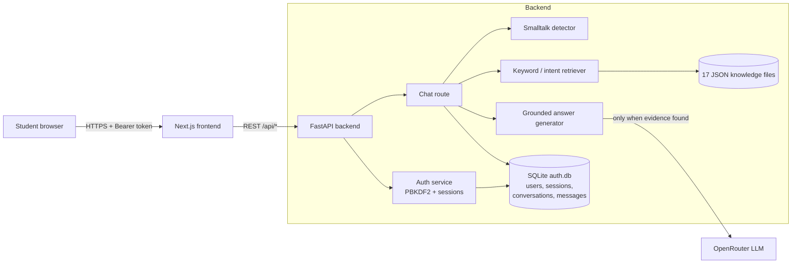
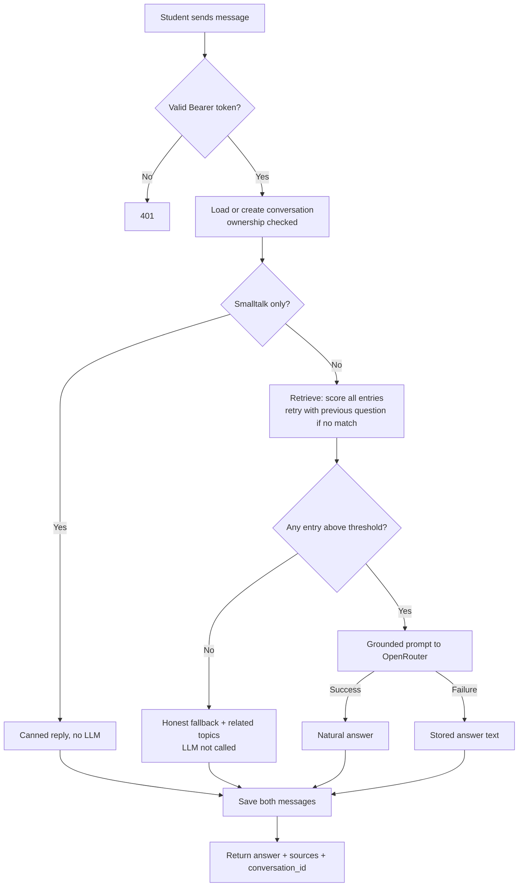

# Campus Expert

**A grounded AI campus assistant for VIT-AP University students.** Students ask everyday campus questions in plain language (hostels, mess, library, exams, fees, transport, faculty, placements and more) and get short, sourced answers. Every answer comes from a curated, cited knowledge base, and every reply shows the official page it came from and whether that fact is verified.


---

## Table of Contents

1. [Overview](#overview)
2. [Problem Statement and Solution](#problem-statement-and-solution)
3. [Key Features](#key-features)
4. [User Roles and Permissions](#user-roles-and-permissions)
5. [Technology Stack](#technology-stack)
6. [Architecture](#architecture)
7. [Project Structure](#project-structure)
8. [How It Works](#how-it-works)
9. [API Reference](#api-reference)
10. [Security Design](#security-design)
11. [Installation and Setup](#installation-and-setup)
12. [Environment Variables](#environment-variables)
13. [Running Locally](#running-locally)
14. [Screenshots](#screenshots)
15. [Limitations and Future Improvements](#limitations-and-future-improvements)
16. [Author](#author)

---

## Overview

Campus Expert is a full-stack web application with a **Next.js** frontend and a **FastAPI** backend. It uses a **retrieval-gated generation** approach:

1. A deterministic keyword and intent retriever finds the relevant facts in a hand-curated JSON knowledge base built from `vitap.ac.in` pages.
2. Only if relevant facts are found, an LLM (configured through **OpenRouter**, set up for a Google Gemma model) rephrases those facts into a natural answer. It is instructed to use only the supplied evidence.
3. If nothing matches, the LLM is **never called**. The student gets an honest "I couldn't find verified information" reply with related topics instead of a guessed answer.

Students sign up with their name, registration number and email, and their conversations are saved to their account. Visitors can also start a one-click **demo session** with sample data.

## Problem Statement and Solution

**The problem.** Campus information at a university is spread across many web pages, PDFs and word of mouth. New students in particular struggle to find simple answers such as hostel rules, mess details, bus routes, library hours or who to contact. A general-purpose chatbot is not a safe fix: asked about a specific campus, it will often produce a confident but invented answer (a wrong curfew time or attendance rule), which is worse than no answer.

**The solution.** Campus Expert answers only from a cited knowledge base:

| Design choice | Why it matters |
|---|---|
| Facts stored with `source`, `source_type` and `last_updated` | Every answer can show where it came from and how fresh it is |
| Retrieval runs **before** generation, and gates it | No matching evidence means no LLM call, so nothing is invented |
| Strict grounding system prompt | The LLM may rephrase evidence but may not add campus facts |
| `official` vs `unverified` labels | Students can see when information is not confirmed |
| Fallback to stored answers if the LLM fails | Chat keeps working even when the LLM provider is down or not configured |

## Key Features

### Fully implemented

**Grounded campus Q&A**
- Natural-language chat over **17 topic categories**: academics, attendance, campus map, campus services, clubs, contacts, examinations, faculty, fees, hostel, important dates, library, medical, mess, placements, student resources and transport.
- **36 knowledge entries** (34 marked `official`, 2 marked `unverified`), each with a source URL on `vitap.ac.in` and a last-confirmed date.
- Keyword, phrase and alias scoring with category ranking. An answer can draw on up to 3 entries, at most one per category.
- **Follow-up handling:** a short follow-up like "what about on weekends?" is resolved using the student's previous question when it has no keywords of its own.
- **Source cards** under each answer showing title, category, a clickable source link, last-updated date and a **Verified / Unverified** badge.
- **Smalltalk handling:** greetings, thanks and goodbyes get instant canned replies with no retrieval or LLM call. A question that opens with "Hi" still gets a real answer that acknowledges the greeting.
- **Out-of-domain fallback:** when nothing matches, the reply says so and suggests real related topics from the knowledge base.
- **Graceful degradation:** if the LLM call fails for any reason (missing key, timeout, HTTP error), the stored answer text is returned instead.
- Lightweight built-in Markdown renderer for answers (bold, inline code, lists, simple tables).

**Accounts and chat history**
- Sign up, log in, log out with server-side sessions.
- Saved conversations per user: a **Recent Chats** sidebar, restore a past chat (with its original source cards), delete a chat.
- Conversation titles are generated from the first message.
- Landing page search bar hands the question straight into a new chat (`/chat?q=...`).

**Demo mode**
- **Try Demo** creates a fresh, isolated demo account with a sample profile, sample settings and two seeded conversations.
- Demo sessions expire after 4 hours, and logging out of a demo deletes the demo account and all its data.
- An app-wide Demo Mode banner, and credential changes are locked for demo users.

**Profile and settings**
- Profile page: view and edit full name, department, year, hostel and bio, plus account statistics (conversation count, question count, member since, last login) computed by the backend.
- Settings page: Light / Dark / System theme, Small / Medium / Large font size, sound toggle, and notification preference toggles. Preferences are saved locally and synced to the account so they follow the student across devices.
- No-flash theme loading on page start.
- **Download My Data:** exports the stored profile and preferences as a JSON file (generated in the browser).

**Resources and UX**
- Resources page with quick links. Four open the official `vitap.ac.in` pages (Academic Calendar, Bus Routes, Mess Menu, Medical Centre). Unlinked ones route to a clear "not linked yet" page instead of a dead button.
- About page, custom 404, error boundary, loading states, skeleton loaders, offline banner, retry buttons on failed messages and failed sidebar actions.
- Responsive layout with a desktop menu and mobile navigation.

### Partially implemented

| Feature | Current state |
|---|---|
| Delete Account (regular users) | Clears the session and local data in the browser only. **No backend endpoint deletes the account row.** For demo users it does fully delete the account. |
| Notification toggles | Saved as preferences. **No notification delivery** (email or push) exists. |
| Change Password | Button shows a message that password management is not built yet. No backend endpoint. |
| Resources page | 4 of 8 cards link to official pages. Student Handbook, Campus Map, Leave Forms and Placement Resources show a "not linked yet" page. |

### Not in use (legacy code kept in the repo)

An earlier version used a **crawl and embed RAG pipeline**: a domain-restricted web crawler, HTML text extraction, chunking, auto-categorization, `sentence-transformers` embeddings stored in SQLite, and a hybrid lexical plus semantic retriever. That code is still in `backend/app/ingestion/`, `backend/ingest.py`, `backend/app/services/semantic_search.py` and `backend/app/services/hybrid_retriever.py`, but **nothing on the live request path imports it**, and its dependencies are commented out in `requirements.txt`. It was replaced with the deterministic retriever for reliability and predictability.

## User Roles and Permissions

There is **no admin role**. The `/admin` route intentionally returns a 404.

| Role | How they get access | What they can do |
|---|---|---|
| **Visitor** | No account | View home, About and Resources pages. Start a demo. Chat requires sign-in. |
| **Registered student** | Sign up with name, registration number, email, password | Chat, save and manage own conversations, edit profile, sync preferences. Session lasts 7 days. |
| **Demo user** | Click **Try Demo** | Same as a student, pre-filled with sample data. Cannot change credentials. Session lasts 4 hours. Account is deleted on logout. |

Every conversation endpoint checks ownership on the server. Requesting another user's chat returns the same 404 as a chat that does not exist.

## Technology Stack

### Frontend

| Area | Technology |
|---|---|
| Framework | Next.js 16.2 (App Router) |
| UI library | React 19.2 |
| Language | TypeScript 5 |
| Styling | Tailwind CSS 4 (via `@tailwindcss/postcss`), CSS variables for theming |
| Icons | `lucide-react` |
| Fonts | Geist and Geist Mono via `next/font/google` |
| Linting | ESLint 9 with `eslint-config-next` |
| Package manager | npm (`package-lock.json`) |

### Backend

| Area | Technology |
|---|---|
| Framework | FastAPI |
| Server | Uvicorn (`uvicorn[standard]`) |
| Validation | Pydantic |
| HTTP client | `httpx` (calls OpenRouter) |
| Config | `python-dotenv` |
| Language | Python 3.13 (the local virtual environment was created with 3.13.9) |

### Data, auth and AI

| Area | Technology |
|---|---|
| Database | SQLite via Python's built-in `sqlite3` (`backend/app/data/auth.db`) |
| Knowledge base | 17 JSON files in `backend/app/data/knowledge/` |
| Password hashing | PBKDF2-HMAC-SHA256, 260,000 iterations, random 16-byte salt (stdlib `hashlib`) |
| Sessions | Opaque random tokens (`secrets.token_urlsafe(32)`) stored server-side, sent as `Authorization: Bearer` |
| LLM access | OpenRouter Chat Completions API. Model is set by `OPENROUTER_MODEL` (the code's example is `google/gemma-4-26b-a4b-it`) |
| Rate limiting | Custom in-memory sliding window, no external dependency |

### Deployment configuration in the code

The backend CORS allow-list includes `https://campus-expert.vercel.app`, and the frontend falls back to a Railway backend URL when `NEXT_PUBLIC_API_BASE_URL` is not set. This indicates a **Vercel (frontend) + Railway (backend)** setup. The repo has no deployment config files (no `vercel.json`, `Dockerfile` or `Procfile`).

## Architecture



**Main components**

| Component | File | Role |
|---|---|---|
| App entry | `backend/main.py` | FastAPI app, CORS allow-list, security headers, router registration, startup knowledge check |
| Chat route | `backend/app/api/chat.py` | Orchestrates smalltalk, retrieval, generation, fallback and persistence |
| Retriever | `backend/app/services/knowledge_retriever.py` | Scores every entry on phrases, keywords, aliases, title and category; ranks categories; returns up to 3 entries |
| Generator | `backend/app/services/answer_generator.py` | Builds the grounded prompt and calls OpenRouter (temperature 0.2, max 400 tokens, 30 s timeout) |
| Smalltalk | `backend/app/services/conversational.py` | Detects greetings, thanks and similar, and returns varied canned replies |
| Knowledge loader | `backend/app/data/knowledge.py` | Loads and validates every `*.json` file in `knowledge/` once at startup |
| Auth | `backend/app/services/auth_service.py`, `security.py` | Signup, login, demo sessions, profile, preferences, stats |
| Storage | `backend/app/data/auth_db.py`, `user_store.py`, `conversation_store.py` | SQLite schema and parameterized queries |
| Rate limit | `backend/app/services/rate_limit.py` | Per-IP limits on unauthenticated endpoints |
| Frontend API layer | `frontend/lib/auth.ts`, `frontend/lib/chat.ts` | All calls to the backend, session storage, error parsing |

## Project Structure

```text
CampusExpert/
├── backend/
│   ├── main.py                      # FastAPI app, CORS, security headers, routers
│   ├── requirements.txt
│   ├── test_gemma.py                # Manual script: checks the OpenRouter connection
│   ├── test_answer_generator.py     # Manual script: runs one grounded answer
│   ├── app/
│   │   ├── api/
│   │   │   ├── auth.py              # /api/auth/* routes
│   │   │   ├── chat.py              # POST /api/chat
│   │   │   └── conversations.py     # /api/chats routes
│   │   ├── schemas/                 # Pydantic request/response models
│   │   ├── services/
│   │   │   ├── knowledge_retriever.py   # Live retriever
│   │   │   ├── answer_generator.py      # Grounded LLM generation
│   │   │   ├── conversational.py        # Smalltalk handling
│   │   │   ├── auth_service.py
│   │   │   ├── security.py              # Password hashing, tokens
│   │   │   ├── rate_limit.py
│   │   │   ├── hybrid_retriever.py      # Legacy, not used
│   │   │   └── semantic_search.py       # Legacy, not used
│   │   ├── data/
│   │   │   ├── knowledge/           # 17 JSON knowledge files (live)
│   │   │   ├── knowledge.py         # Knowledge loader
│   │   │   ├── auth_db.py           # SQLite schema (auth.db, created at runtime)
│   │   │   ├── user_store.py
│   │   │   ├── conversation_store.py
│   │   │   ├── knowledge_base.json  # Legacy v3 data, not loaded
│   │   │   ├── db.py, chunk_store.py    # Legacy pipeline storage
│   │   └── ingestion/               # Legacy crawler, extractor, chunker, categorizer
│   ├── ingest.py, urls.txt          # Legacy ingestion entry point and seed URLs
│   ├── scripts/                     # Copy of the legacy ingestion script
│   └── knowledge_base/              # official/ and student/ folders with placeholder PDFs (not used by the live app)
├── frontend/
│   ├── app/
│   │   ├── page.tsx                 # Landing page
│   │   ├── chat/                    # Chat interface
│   │   ├── login/, signup/, demo/
│   │   ├── profile/, settings/
│   │   ├── resources/               # Resources + coming-soon page
│   │   ├── about/
│   │   ├── admin/                   # Returns 404 by design
│   │   ├── layout.tsx, error.tsx, loading.tsx, not-found.tsx
│   ├── components/
│   │   ├── chat/                    # ChatHeader, ChatSidebar, ChatMessage, SourceCard, ...
│   │   ├── home/                    # Hero, SearchBar, SuggestedQuestions, Features
│   │   ├── layout/                  # Navbar, Footer
│   │   └── ui/                      # Button, Card, Skeleton, banners, EmptyState
│   ├── lib/                         # auth, chat, errors, theme, preferences, hooks
│   └── package.json
├── SECURITY_AUDIT_REPORT.md
├── PERFORMANCE_AUDIT_REPORT.md
└── PRE_DEMO_QA_REPORT.md
```

## How It Works

### Request flow for `POST /api/chat`



### Retrieval scoring

Each knowledge entry is scored against the question. Generic words (for example "the", "campus", "student", "timings") are ignored.

| Signal | Weight |
|---|---|
| Exact multi-word keyword phrase in the question | 4.0 |
| Exact alias phrase in the question | 3.0 |
| Single-word keyword match | 1.0 |
| Category name appears in the question | 1.0 |
| Single-word alias match | 0.75 |
| Keyword token overlap | 0.5 |
| Title token overlap | 0.5 |
| Alias token overlap | 0.4 |

An entry needs a score of at least **1.0** to count. Only the best entry per category is kept, up to **3** per answer.

### Knowledge entry format

```json
{
  "id": "library_001",
  "title": "Library Hours",
  "category": "library",
  "keywords": ["library", "library hours"],
  "aliases": ["when does the library close"],
  "content": "Plain-sentence fact, traceable to the source URL.",
  "source": "https://vitap.ac.in/...",
  "source_type": "official",
  "last_updated": "YYYY-MM-DD"
}
```

To add knowledge, add entries to an existing file or drop a new `<category>.json` file into `backend/app/data/knowledge/`. No code change is needed. The loader skips malformed files with a warning instead of crashing.

## API Reference

All routes are prefixed with `/api` except the health checks. Interactive docs are available at `http://localhost:8000/docs` when the backend is running (FastAPI default).

| Method | Path | Auth | Description |
|---|---|---|---|
| GET | `/` | No | Status message |
| GET | `/health` | No | Health check |
| POST | `/api/auth/signup` | No | Create account (rate limited: 10/min per IP) |
| POST | `/api/auth/login` | No | Log in (rate limited: 10/min per IP) |
| POST | `/api/auth/demo` | No | Create a demo account (rate limited: 5/min per IP) |
| POST | `/api/auth/logout` | Optional | End session (deletes the account if it is a demo) |
| GET | `/api/auth/me` | Yes | Current user |
| PATCH | `/api/auth/me` | Yes | Update profile fields |
| PATCH | `/api/auth/preferences` | Yes | Update theme, font size, notifications, sound |
| GET | `/api/auth/stats` | Yes | Conversation and question counts |
| POST | `/api/chat` | Yes | Ask a question (message 1 to 4,000 chars) |
| GET | `/api/chats` | Yes | List own conversations |
| GET | `/api/chats/{id}` | Yes | Get one conversation with messages |
| DELETE | `/api/chats/{id}` | Yes | Delete a conversation |

Auth errors return a `{ "field": ..., "message": ... }` body so the frontend can show the error next to the right form field.

## Security Design

Security decisions visible in the code:

- **Password storage:** PBKDF2-HMAC-SHA256 with 260,000 iterations and a per-user random salt. Verification uses constant-time comparison. The iteration count is stored with each hash so it can be raised later.
- **Sessions:** opaque random tokens with server-side expiry (7 days, 4 hours for demos). Logout deletes the session row, so revocation is immediate.
- **Authorization:** every conversation query is scoped to the signed-in user. Foreign and missing chats return the same 404, so chat IDs cannot be probed.
- **Input validation:** Pydantic schemas with length limits. The chat message is capped at 4,000 characters, which also limits LLM cost abuse.
- **SQL injection:** all queries are parameterized.
- **Rate limiting** on the three unauthenticated endpoints (signup, login, demo).
- **CORS:** regex allow-list (localhost, private LAN ranges on port 3000, and the Vercel origin), `allow_credentials=False`.
- **Security headers:** `X-Content-Type-Options: nosniff`, `X-Frame-Options: DENY`, `Referrer-Policy: same-origin`.
- **Prompt injection mitigation:** the system prompt tells the model to treat retrieved evidence and chat history as data, never as instructions.
- **Secrets handling:** the OpenRouter key is read from `backend/.env` only, never logged or returned to the client. `.env` files and `*.db` files are listed in `.gitignore`.

The repository also includes `SECURITY_AUDIT_REPORT.md`, `PERFORMANCE_AUDIT_REPORT.md` and `PRE_DEMO_QA_REPORT.md`, which document the review passes done on the project.

## Installation and Setup

### Prerequisites

- **Python 3.13** (the version the project was developed with)
- **Node.js 20.9 or later** (required by Next.js 16) and npm
- An **OpenRouter API key** (optional: without it, chat still works and returns the stored answer text)

### 1. Clone the repository

```bash
git clone https://github.com/<your-username>/CampusExpert.git
cd CampusExpert
```

### 2. Backend setup

```bash
cd backend
python -m venv venv
```

Activate the virtual environment:

```bash
# Windows (PowerShell)
venv\Scripts\Activate.ps1

# macOS / Linux
source venv/bin/activate
```

Install dependencies:

```bash
pip install -r requirements.txt
```

The SQLite database (`app/data/auth.db`) is created automatically on first run.

### 3. Frontend setup

```bash
cd ../frontend
npm install
```

## Environment Variables

Never commit real values. Both `.env` and `.env.*` are already ignored by `.gitignore`.

### `backend/.env`

```env
# OpenRouter API key (https://openrouter.ai). Keep this secret.
OPENROUTER_API_KEY=your_openrouter_api_key_here

# OpenRouter model ID used for grounded answers
OPENROUTER_MODEL=google/gemma-4-26b-a4b-it
```

| Variable | Required | Purpose |
|---|---|---|
| `OPENROUTER_API_KEY` | No (recommended) | Enables LLM-phrased answers. If missing, the backend logs a warning and chat falls back to stored answer text. |
| `OPENROUTER_MODEL` | No (recommended) | The OpenRouter model ID. Needed together with the key. |

### `frontend/.env.local`

```env
# Base URL of the FastAPI backend
NEXT_PUBLIC_API_BASE_URL=http://localhost:8000
```

| Variable | Required | Purpose |
|---|---|---|
| `NEXT_PUBLIC_API_BASE_URL` | **Yes for local development** | Where the frontend sends API calls. If unset, the code falls back to the deployed Railway backend, not your local one. Values are inlined at build time, so restart `npm run dev` after changing it. |

## Running Locally

Run the backend and frontend in two terminals.

**Terminal 1: backend** (from `backend/`, with the virtual environment active)

```bash
uvicorn main:app --reload --port 8000
```

- API: `http://localhost:8000`
- Health check: `http://localhost:8000/health`
- Interactive API docs: `http://localhost:8000/docs`

**Terminal 2: frontend** (from `frontend/`)

```bash
npm run dev
```

Open `http://localhost:3000`, then sign up or click **Try Demo**.

Other frontend scripts:

```bash
npm run build   # Production build
npm run start   # Serve the production build
npm run lint    # ESLint
```

Optional backend checks (manual scripts, not an automated test suite):

```bash
python test_gemma.py              # Confirms the OpenRouter key and model work
python test_answer_generator.py   # Generates one grounded answer from sample evidence
```

**Testing on a phone on the same Wi-Fi:** the backend CORS list allows private LAN addresses on port 3000, and `next.config.ts` allows the machine's LAN IPs as dev origins. Run the backend with `--host 0.0.0.0` and set `NEXT_PUBLIC_API_BASE_URL` to `http://<your-LAN-IP>:8000`.

## Screenshots

> Screenshots to be added.

| Screen | Preview |
|---|---|
| Landing page | `docs/screenshots/home.png` |
| Chat with source cards | `docs/screenshots/chat.png` |
| Out-of-domain fallback | `docs/screenshots/fallback.png` |
| Login / Signup | `docs/screenshots/auth.png` |
| Profile and stats | `docs/screenshots/profile.png` |
| Settings (dark mode) | `docs/screenshots/settings.png` |
| Resources | `docs/screenshots/resources.png` |

## Limitations and Future Improvements

### Current limitations

- **Small knowledge base.** 36 entries across 17 categories. Questions outside them get the fallback reply.
- **Keyword retrieval only.** No semantic matching, so phrasings that share no keywords or aliases with an entry will not match.
- **No admin interface.** Knowledge is edited by hand in JSON files.
- **Account deletion is client-side only** for regular users; the server account stays.
- **No password change or password reset.**
- **Notification toggles are stored but nothing is sent.**
- **In-memory rate limiting** resets on restart and is not shared across multiple server workers.
- **SQLite** is a single local file, suitable for a prototype but not for multiple backend instances.
- **Session tokens** are stored in plain form in the database and in browser `localStorage` on the client.
- **Debug logging is on by default** (`DEBUG_RETRIEVAL = True`), printing queries and retrieval traces to the server console.
- **No automated test suite.** Only two manual backend scripts exist.
- **Legacy code** from the earlier embedding pipeline is still in the repo but unused.

### Planned or suggested improvements

- Backend endpoints for password change, password reset and real account deletion.
- Admin dashboard for editing and reviewing knowledge entries.
- Expand the knowledge base and fill in the four unlinked Resources items.
- Optional semantic retrieval layer on top of keyword matching (the legacy pipeline is a starting point).
- Hash session tokens at rest and consider httpOnly cookies.
- Move to PostgreSQL and a shared rate-limit store (for example Redis) for production.
- Automated tests with `pytest` for the retriever and API, plus frontend tests.
- Remove or archive the unused legacy pipeline files.
- Turn debug logging off through an environment setting in production.

## Author

**[Your Name]**
Student, [Program / Specialization], [University]

- GitHub: [@your-username](https://github.com/your-username)
- LinkedIn: [your-linkedin](https://www.linkedin.com/in/your-linkedin)
- Email: [your-email@example.com](mailto:your-email@example.com)

---

*Campus Expert is an independent student project and is not an official VIT-AP University service. Always confirm important information with the university.*
